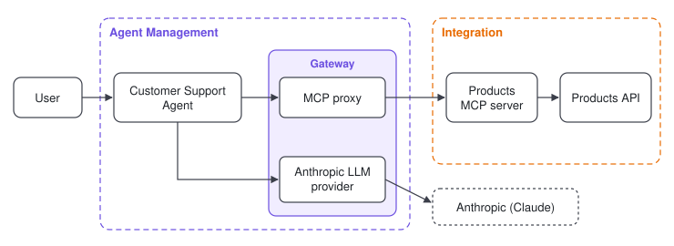

# Customer Support Agent

A support agent for a demo outdoor gear store. Users ask about products, stock and store policies, and the agent
answers with live product data. It shows an AI agent, an MCP server and an API working together across WSO2 Cloud.



**What gets deployed**

- **Agent Management:** the Customer Support Agent
- **Integration:** the Products MCP server and the Products API

**How it fits together:** the agent finds answers through the Products MCP server, which reads the Products API.
Agent Management makes the MCP server and the LLM available to the agent through its gateway.

**Needs:** an Anthropic LLM provider in Agent Management.

| Component | Runs on | Path | Language |
|---|---|---|---|
| Products API | Integration, REST API, reachable only inside the project | `products-api/` | Ballerina 2201.13.1 |
| Products MCP server | Integration, `mcp-server` | `products-mcp/` | Ballerina 2201.13.1 |
| Customer Support Agent | Agent Management, platform-hosted chat agent | `agent/` | Python 3.11 |

The store is Summit Outdoor, a fictional store. The catalog, stock and policies are mock data, and everything is
read-only.

## Deploy on WSO2 Cloud

Deploy all three into the same project, to Development, in this order.

### 1. Deploy the Products API

In Integration, create an integration from this repository: REST API, path `products-api`, WSO2 Integrator
runtime. Deploy it. Leave its endpoint as it is: it's for the project only.

### 2. Deploy the MCP server

Create another integration from this repository: type `mcp-server`, path `products-mcp`, WSO2 Integrator runtime.
It needs no environment variables. Build it, then connect it to the API before you deploy it:

1. In its **Configure** form, link the `productsApiUrl` configurable to the Products API's endpoint. The MCP server
   then calls the API inside the project, with no gateway and no API key, and the platform keeps the address up
   to date.
2. Deploy it.
3. Make its endpoint public, so Agent Management adds it as an MCP proxy on its gateway.

### 3. Deploy the agent

In Agent Management, create a platform-hosted Python agent from this repository: app path `/agent`, Python 3.11,
default chat interface. Then:

1. Bind an Anthropic LLM provider, with the env var names `LLM_PROVIDER_URL` and `LLM_PROVIDER_KEY`.
2. Bind the MCP proxy from step 2, with the env var names `PRODUCTS_MCP_URL` and `MCP_API_KEY`.
3. Deploy, then open **Try It** and ask, for example, "Is the Trailblazer jacket in stock in size M?".

## Products API

A read-only REST API over mock data, with no auth code: it's reachable only from inside the project. Base path
`/api/v1`, port `8080`.

| Method and path | Returns |
|---|---|
| `GET /products?query=&category=` | Matching products, best rated first |
| `GET /products/{sku}` | One product |
| `GET /products/{sku}/stock` | Units per size |
| `GET /policies`, `GET /policies/{topic}` | Store policies: returns, shipping, warranty, price-match |
| `GET /health` | `{"status":"ok"}` |

## Products MCP server

Port `9090`, path `/mcp`, stateless. Four read-only tools:

| Tool | What it does |
|---|---|
| `searchProducts` | Search by words and optional category |
| `getProduct` | Full product details |
| `checkStock` | Units per size |
| `getPolicy` | One store policy |

A `404` from the API is reported as "not found"; any other failure as the catalog being unavailable, and logged.

| Env var | Default | Purpose |
|---|---|---|
| `PRODUCTS_API_URL` | `http://localhost:8080` | The Products API's address, with or without `/api/v1`, for local runs |

| Configurable | Default | Purpose |
|---|---|---|
| `productsApiUrl` | empty, which falls back to `PRODUCTS_API_URL` | The Products API's address. On WSO2 Cloud, link it to the API's endpoint |

## Customer Support Agent

Serves `POST /chat` on port `8000` (`{"message", "session_id"}` in, `{"response", "session_id"}` out) and
`GET /health`. Agent Management starts it with `python main.py`.

| Env var | Required | Purpose |
|---|---|---|
| `PRODUCTS_MCP_URL` | Yes | The MCP gateway URL plus `/mcp` |
| `MCP_API_KEY` | When the MCP gateway checks keys | Sent as `X-API-Key`. Store it as a secret |
| `LLM_PROVIDER_URL`, `LLM_PROVIDER_KEY` | When `USE_LLM_PROVIDER=true` | Injected by Agent Management from the bound Anthropic provider |
| `USE_LLM_PROVIDER` | No, default `true` | `false` for a local run straight against Anthropic |
| `ANTHROPIC_API_KEY` | When `USE_LLM_PROVIDER=false` | Local runs only |
| `MODEL` | No, default `claude-opus-5-5` | Claude model |
| `MAX_TOKENS` | No, default `16000` | Cap on each reply |
| `STORE_NAME` | No, default `Summit Outdoor` | Name used in the instructions |

The agent sends the provider key in `API-Key`, which the Agent Management gateway reads, and calls
`<LLM_PROVIDER_URL>/v1/messages` (a trailing `/v1` on the URL is dropped first).

## Run locally

```bash
cd products-api && bal run
```

```bash
cd products-mcp && bal run
```

```bash
cd agent
python -m venv .venv && source .venv/bin/activate
pip install -r requirements.txt
export PRODUCTS_MCP_URL=http://localhost:9090/mcp USE_LLM_PROVIDER=false ANTHROPIC_API_KEY=<your-key>
python main.py
```

```bash
curl -X POST http://localhost:8000/chat -H "Content-Type: application/json" \
  -d '{"message": "Is the Trailblazer jacket in stock in size M?", "session_id": "demo"}'
```
